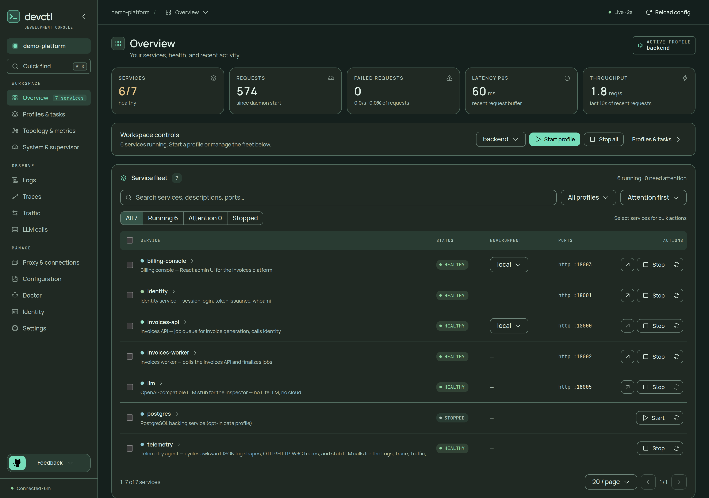
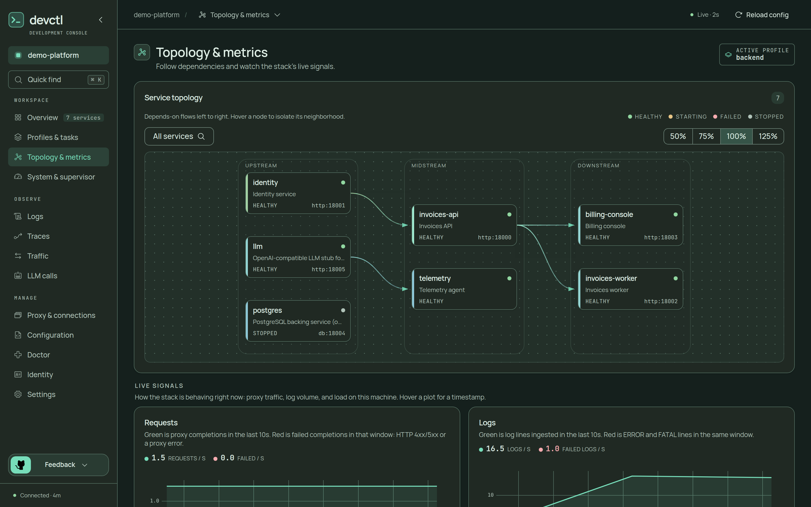
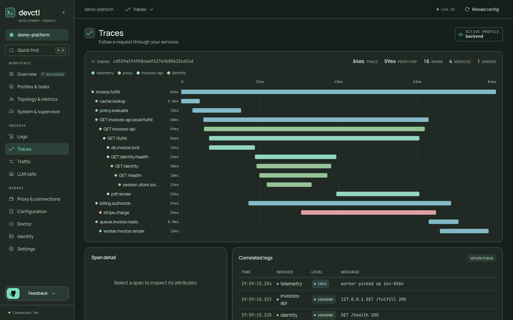
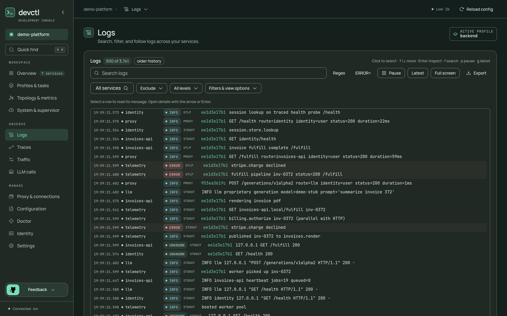

# Web console

Operate your local stack and investigate requests in a browser. The web console shares the supervisor with the TUI, CLI, and MCP, so a service started in one appears in the others.



## Open your session

From a repository with a valid devctl configuration:

```bash
devctl web start --print-url
```

Open the printed link. Its URL fragment carries the control token that lets the console start, stop, and restart services. Keep that link private. The browser stores the token after the first authorized visit, so closing the tab and opening the same origin again stays authorized. The saved token is kept until `devctl web rotate` (or the same `regenerate_session_tokens` preference as MCP, off by default, which remints it after 7 days). Plain `devctl web start` prints only the origin; it does not print the token. Starting the console does not start a service profile: choose one in the console or use `devctl start --profile <name>`.

The console is off by default and normally listens at `http://127.0.0.1:18900`. You can check or stop its listener independently:

```bash
devctl web status
devctl web stop
devctl web rotate
devctl web rotate --print-url
```

Stopping the web listener leaves your services running. Use `devctl down` when you want to shut down the session.

**Settings** (`#/settings`, gear in the nav) share the TUI preference model: this-repository overlay by default, or all checkouts. Appearance, scroll, and log columns write `tui.json` layers. **Regenerate tokens** writes `regenerate_session_tokens` (off by default). On remints the saved MCP and web bearer tokens after 7 days, the next time that listener reads them. **Web console on/off and port** write `web.enabled` / `web.listen.port` into gitignored `.devctl/config.local.yaml` (created if missing) and reload so the listener starts, stops, or rebinds. **Inspect body cap** writes `proxy.inspect_max_bytes` and `llm.capture_max_bytes` (1 / 4 / 8 / 16 MiB) so large request/response bodies are kept; a route or source that sets `max_bytes` still wins. Confirm before turning the console off while this tab is open. You can still enable it from YAML:

```yaml
web:
  enabled: true
  listen:
    host: 127.0.0.1
    port: 18900
```

Run `devctl config validate` after a hand edit, then `devctl reload` if the supervisor is already running. A settings save already reloads. The port must differ from the proxy, token endpoint, OTLP receiver, and gRPC route ports. The listener accepts loopback addresses only. See [Security](security.md) for the access model.

## Choose a color theme

Open **Settings → Appearance** for the same 28 named palettes as the TUI, including Dracula, Tokyo Night, Catppuccin, Nord, Gruvbox, Solarized, and the high-contrast themes. Search by name or description, or filter the preview grid by light/dark appearance. Choosing a palette saves the shared theme preference using the selected repository/user scope and starts with that palette's native appearance.

**Mode** overrides the web palette to light or dark independently of the TUI. Named pairs such as Catppuccin Mocha/Latte and Solarized Dark/Light use their matching variant; other palettes adapt their surfaces and colors for readable contrast. Theme changes cover navigation, controls, logs, JSON, traces, and charts. The last applied theme is cached for the next page load, and the console checks for changes made through the TUI.

## Control services

The overview combines service status, recent proxy requests, and errors. Start a profile to bring up a group, or use a service's start, stop, and restart controls. The service fleet searches names, descriptions, ports, states, and environment names. Narrow it by profile or running/attention/stopped state, then sort by name, state, or attention first. Pagination keeps large workspaces manageable. Select a page or individual services for bulk actions; the selection bar also reports selections outside the current page.

Open a service name to inspect its command, working directory, dependencies, ports, last error, and configured environment values with secrets redacted. The detail view links directly to that service's logs. **Resolve environment** shows the values a new command will receive, including devctl templates. Values are redacted by default; **Reveal secrets** requires review and keeps them only in the open inspector. **Run command** executes an argument list in the service's environment and working directory, with captured stdout, stderr, and exit code. Shell operators are ordinary arguments; invoke a shell explicitly when needed.

**Preview plan** shows dependency waves and blockers before starting or stopping services, selections, or profiles. **Profiles & tasks** separates working sets from one-off tasks. Profile cards show member services and health; task runs show stdout, stderr, and the exit code. **Proxy & connections** shows listener status and searchable routes, including host/path matches, protocol, dedicated gRPC listeners, and route details. Its **MCP & agent tools** tab starts or stops MCP, shows client setup snippets on request, rotates the bearer token, and edits tool permissions by category or search. Reviewed permission changes persist to this repository. **Configuration** shows service definitions, a JSON summary, and searchable winning sources and overridden layers.

The navigation groups workspace, observation, and management pages. Every page title shows its navigation icon; the top-bar page menu also switches between sections. Filtering controls use shadcn dropdown menus with keyboard navigation. Use the arrow beside the logo to collapse the sidebar into an icon rail or expand it again. The browser remembers this choice; hovering an icon shows its page name. On smaller screens navigation moves into a menu. **Quick find** (`Cmd+K` / `Ctrl+K`) searches pages and service names from any section.

When a service defines [named environment overlays](environment.md#per-service-named-overlays), use its Env selector in Overview or Graph. The selection becomes pending until you restart the service; the console offers a Restart action to apply it.

Lifecycle rules match the CLI: stopping a service also stops its dependents; restarting a service normally restarts only that service. Stop confirmations list dependent services. When dependents exist, Overview and Graph ask **selected only** vs **include dependents** (same as TUI `R` / `c`). See [Services](services.md#start-stop-restart) before stopping a shared dependency.

## Edit configuration and create drafts

Open **Configuration → Edit config** to edit the active YAML file. The editor preserves the original text, comments, and formatting. **Compare** shows the original beside the draft. Drafts survive navigation within the console; leaving or reloading the browser warns about unsaved changes.

**Validate draft** uses the same loader as `devctl config validate`; saving stays disabled until that exact draft passes. **Save & reload** atomically replaces the active file, then reloads the supervisor. A revision check rejects saves if another editor changed the file. Your draft stays available so you can compare or copy it before reloading from disk. A successful save lists services needing restart; reload failures are reported separately from the disk save. Layered overrides remain visible under **Sources & overrides**.

**Import / setup** creates a starter draft from project, profile, proxy port, service account, and IAP audience fields, or converts pasted Docker Compose YAML. Unsupported Compose fields are listed for review. Neither operation writes until you validate and confirm the draft. The editor can contain unredacted values from your file; it requires the web bearer and responses are not cached. MCP configuration inspection remains redacted.

## Explore the dependency graph



Open Topology & metrics to see dependencies alongside current service state and runtime signals. Search for a service to center its node, change the zoom, and scroll within the graph. Use it to understand which services sit upstream of a failure before deciding what to restart.

The overview **Requests** and **Failed requests** tiles are lifetime proxy totals for this supervisor. A failed request is an HTTP status of 400 or higher, or a proxy error. The subtitle rate is the last 10 seconds of the recent request buffer. **Recent errors** is still ERROR and FATAL log lines, with a lifetime log-error badge.

Graph charts use that same 10-second window: requests against failed requests from the recent proxy buffer, and log lines against ERROR and FATAL lines from the lifetime log counters (`logs.seen` and `logs.seenErrors`). Latency is the recent request buffer. Those windows need not match the lifetime tiles. Open Logs for the live ring (up to `logs.max_memory_events`, default 50,000).

## Follow a request into its trace



1. Find a request in the overview's recent proxy traffic, or open Traces.
2. Open its trace to inspect the span waterfall and identify an error or slow operation.
3. Inspect the correlated logs for the same trace to see what the service reported.
4. Make your change, restart the affected service if needed, and repeat the request.

The proxy emits request spans. Deeper application spans require your services to emit trace data; opening the console alone does not instrument them. The optional receiver accepts **OTLP/HTTP** as JSON or protobuf, not gRPC. See [Telemetry](telemetry.md) for setup, or use the [tracing example](examples.md#follow-a-distributed-trace) to explore a working session.

## Read logs, LLM calls, and traffic



Open Logs to follow the supervisor ring. The page keeps up to `logs.max_memory_events` events (default 50,000), virtualizes the viewport, and polls only new lines with `next_cursor` while the tab is visible and live. Scroll up to backfill older pages (`prev_cursor`, `direction=backward`). Pause freezes follow; **Clear** hides earlier lines in this tab without touching the daemon. Filter chips use `/api/logs/stats` counts, not whatever is on screen.

Search is substring or regex (`f` focuses the box). A searchable service picker replaces an unbounded strip of service chips. **Filters & view options** opens a dropdown for noise filters and display controls, with submenus for wrapping and session history. **All filters & session history** opens time bounds, source, request/trace IDs, and attribute filters in a dialog. These controls float over the page, leaving the taller log list available behind them. Date/time inputs use the browser's local timezone. **ERROR+** (`e`), the Levels menu (choose multiple severities), **hide health**, the system-source toggle (`auth` / `mcp` / `devctl` / `proxy`), and **hide grpc** (`b`) match the TUI. Hide health drops supervisor probes and request logs for HTTP health/ready/live endpoints and gRPC `grpc.health.v1.Health`, from the service and from the proxy. Hide grpc drops gRPC proxy logs from the page, the facet counts, and export; HTTP proxy logs stay. Advanced filters select source, request ID, trace ID, or an exact attribute key/value; **Deduplicate requests** groups repeated request IDs. These filters and the system-source toggle apply on the supervisor, so paging, counts, and exports use the same filter. **Full screen** (`z`, Escape to leave) hides surrounding chrome. Wrap cycles clip → wrap selected → wrap all (`w`). Split (`\`) opens a second pane on the same buffer with its own service filter and follow/pin. History loads a persisted session; **Export** downloads NDJSON using the selected session and query filters. Keys on Logs: `j`/`k` move, `f` search, `p` pause, `g` latest (`pinned · +N new` when you leave the tail), `e` ERROR+, `b` gRPC logs, `\` split, `w` wrap. Select a row to pin the view and expand its message; the selected row has a clear highlight. Arrow keys or j/k move through records, and Enter or the row’s inspect arrow opens details. Wide screens show a closable side panel; smaller screens open details separately, preserving the log list’s height and scroll position. Details start with the readable message and metadata, with JSON available in a separate tab. In the JSON tree, click a long field or **Show more** to read its full value with line breaks and wrapping; **Show less** folds it back. Enter expands or folds the selected value, and the Value button copies the full text. Use the selection bar to move, copy the message, inspect, or clear selection. Latest returns to live follow and clears selection. Narrow log rows stack metadata above the message so service names never crowd it out. Service stdout and stderr work without enabling OTLP. See [Logs](logs.md) for retention and export.

The LLM view is a list plus live inspector. Caller, status, and model filters query the supervisor, with a searchable caller picker. Pause holds the list; **Load older calls** pauses live refresh while browsing history, and **Back to live** returns to the newest page. A pinned call stays open across filter changes, with a notice when it is outside the current results. Select a call to read the conversation, or switch to JSON for a collapsible tree (path breadcrumb, expand/collapse, copy path or value) and a syntax-colored pretty view. Find highlights matching keys and values. The selected call stays open when newer calls arrive. Search matches prompts and metadata stored on the supervisor. Enable and configure [LLM inspector](llm.md) separately: either pull LiteLLM spend logs or capture traffic on a devctl proxy route. An empty LLM view does not mean the web console is broken; it needs a configured source receiving traffic.

## Inspect proxied HTTP and gRPC bodies

The Traffic view (`#/traffic` and `#/traffic/:id`) is a list plus live inspector for hops captured on `inspect.enabled` proxy routes. The searchable caller picker keeps one originating service (or hops with no caller) so a noisy neighbor does not bury the service you are debugging. Route, method, protocol, and status filters query the supervisor. Pause and **Load older requests** let you browse history; **Back to live** returns to the newest page. Click a row to inspect JSON as a navigable tree or syntax-colored pretty text (copy path/value, find, wrap), or switch to raw. Logs and span attributes use the same viewer. The selected hop stays open when newer hops arrive. `j`/`k` moves the list. Overview request paths link here when a captured body exists. Direct sockets that never hit the proxy are not shown. See [Proxy inspect](proxy.md#inspect-bodies).

## Doctor and identity

**Doctor** (`#/doctor`) is in the management navigation. Search checks or choose Issues only to focus on failures and warnings. It runs the same checks as `devctl doctor` on visit and on Refresh, with severity, message, and hint. Each error port that names a holder offers **Free port** after you review the process ID, command, and port. When two or more of those ports are listed, **Free all N ports** stops each one after a single confirmation. One failure does not skip the rest. The supervisor rechecks the holder before every signal, then refreshes the report. See [Doctor](doctor.md).

**Identity** (`#/identity`) shows user, project and its source, ADC, IAP, and service-account probe status. **Sign in with Google** starts gcloud on the devctl machine without launching its browser. Open the provided Google link, complete sign-in, and paste the authorization code into the console. gcloud owns OAuth and credential persistence. Only one sign-in runs at a time; you can cancel it, and unfinished sessions expire after ten minutes. The code is never included in status or logs.

Refresh identity, revoke ADC with **Sign out**, or clear cached tokens. **Credentials** lists cached identities, audiences, and expiry metadata without token values. **Token activity** searches the same refresh, failure, and identity-change timeline as the TUI.

## System and maintenance

**System & supervisor** (`#/system`) shows host CPU and memory, per-service CPU, memory, restarts and uptime, supervisor memory and event-loop lag, and log-pipeline statistics. **Bootstrap logs** reads the startup log with redaction. **Maintenance** checks for updates and offers the detected installation method after review; restart devctl afterward. Shutdown offers separate reviewed choices to leave services running or stop them with the supervisor.

## If something is missing

| Symptom | Next step |
|---|---|
| Browser cannot connect | Run `devctl web status`, then `devctl web start --print-url`; use the address it prints. |
| Pages load but controls fail | Reopen the access link from `devctl web start --print-url` after `devctl web rotate`, after a remint when `regenerate_session_tokens` is on, a different repository on the same port, or a missing first-time authorization. |
| Service list is stopped | Start the intended profile; enabling the console does not launch your application. |
| No application traces | Check your instrumentation and OTLP/HTTP exporter configuration in [Telemetry](telemetry.md). |
| Cannot bind the listener | Check for a port conflict with `devctl doctor` or `#/doctor` and choose an unused loopback port. |
| ADC missing | Open Identity and choose **Sign in with Google**, or use `devctl auth login`. |

## Related

- [Examples & recipes](examples.md)
- [TUI](tui.md)
- [CLI](cli.md)
- [Telemetry](telemetry.md)
- [LLM inspector](llm.md)
- [Proxy](proxy.md)
- [Doctor](doctor.md)
- [Logs](logs.md)
